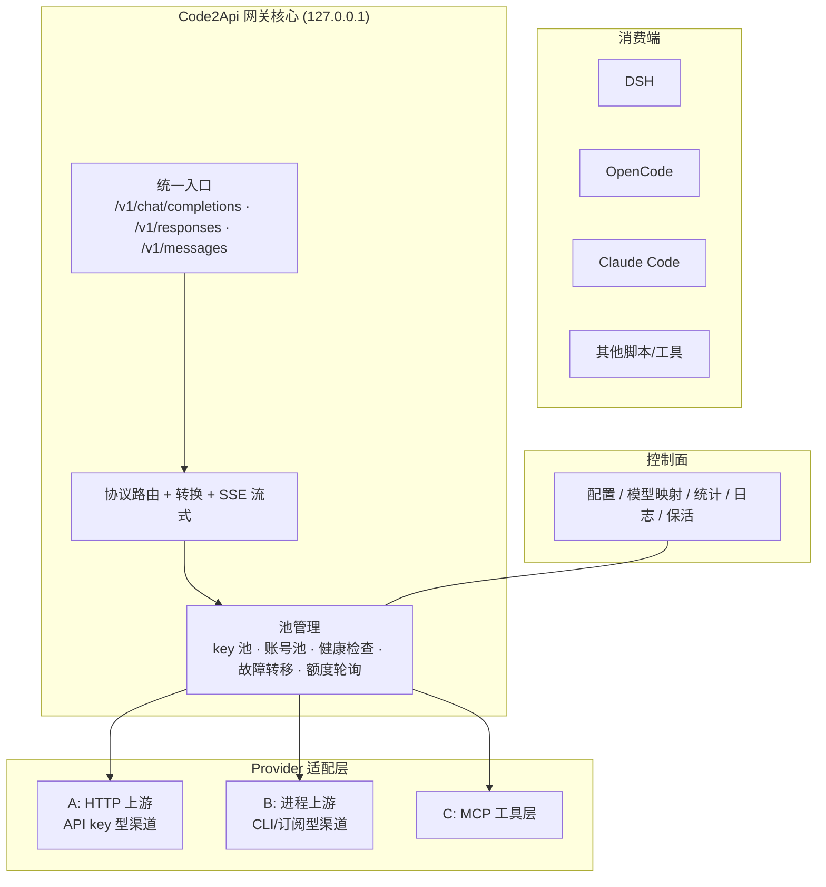
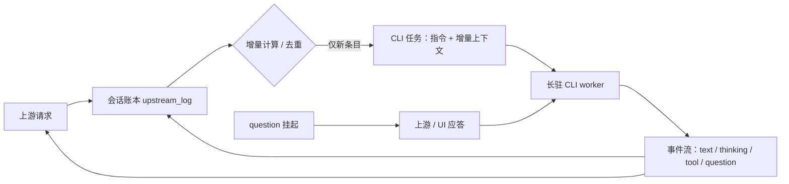
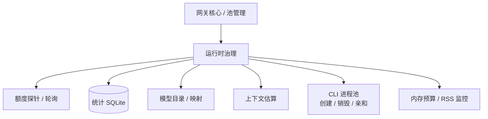

# Code2Api 可行性分析

> 本地 AI 渠道网关：把「API key 型转发站」与「CLI/订阅型渠道」统一池化，对外暴露 OpenAI / Anthropic 兼容 API，供 DSH、OpenCode、Claude Code 等本地 Agent 消费。
>
> 状态：可行性分析（2026-11-20）。独立新项目，与 game_auto 无关。

## 1. 背景与目标

- **动机**：手上有大量"白嫖渠道"（免费/低价 API 额度 + 订阅制 CLI），各自协议、额度、key 管理方式都不同；希望自建一个本地网关，统一入口、统一池化、统一监控，让本地 Agent 像用一个 OpenAI 兼容服务一样用这些渠道。
- **目标形态**：单进程常驻本机（`127.0.0.1` 监听），一个入口，多渠道池，协议互转，故障转移，额度可见。
- **非目标**：不做公网服务、不做多租户、不碰游戏自动化业务逻辑。

## 2. 渠道盘点（两类，对应两条路线）

| 类型 | 典型渠道 | 接入方式 | 路线 |
|---|---|---|---|
| **API key 型**（转发站 / 聚合平台 / 兼容站） | 各类 OpenAI 兼容站、OpenRouter 类聚合、厂商官方 API 免费额度 | base_url + key，标准 HTTP（OpenAI Chat / 或自有协议） | **A** |
| **CLI / 订阅型**（只有客户端 + 订阅） | OpenCode Go、GitHub Copilot、Claude Max、Gemini 订阅、Kilo 本地内核等 | 本地 CLI 子进程桥接 / 本地 HTTP 内核 / 本地数据目录 | **B** |
| **MCP 型**（工具协议） | 渠道附带的 MCP server | 聚合 tools，作补充 | **C** |

> 关键判断：**两类都有 ⇒ 网关必须同时支持「HTTP 上游」与「进程上游」两种 provider 适配层**，这是本项目的核心设计约束。

## 3. 技术路线

### 路线 A：HTTP 上游（API key 型）
- 渠道给 base_url + key，网关做协议转换（OpenAI Chat ↔ Anthropic Messages ↔ Responses）+ 多 key 池 + 故障转移 + 额度统计。
- 最成熟、成本最低；copilot-api / ccg-gateway 已验证。

### 路线 B：进程上游（CLI / 订阅型）
- 拉起本地 CLI 子进程（如 `opencode serve`），把网关请求喂进去、把流式响应转回标准协议。
- 参考实现：`ILVACM/DSH-Opencode2API-hbk`（复用本机已登录 CLI，规避直连风控）、`StarryKira/copilot2api-go`（官方 CLI SDK）、`Lordymine/opencode-go-cli`（本地 Bun 代理）。
- 代价：进程治理（启停/看门狗/重启预算/端口分配/并发会话隔离）、交互式审批、流式转发。

### 路线 C：MCP 工具层（补充）
- 渠道若提供 MCP server，网关聚合其 tools（参考 copilot-api 的 `tool_search` bridge、ccg-gateway 的 MCP 配置复用）。
- 注意：MCP 是工具协议，不是模型通道，只作 A/B 的补充。

## 4. 参考项目（生态已验证）

| 项目 | 形态 | 借鉴点 |
|---|---|---|
| [caozhiyuan/copilot-api](https://github.com/caozhiyuan/copilot-api)（MIT，1.1k★） | 本地网关，三协议统一入口，多 provider 池，含 DSH 集成插件 `dsh-copilot-api`，Electron 桌面端 | **首选基线**：协议转换 / 流式 / 用量监控 |
| [mos1128/ccg-gateway](https://github.com/mos1128/ccg-gateway) | 桌面网关：四协议互转、故障转移、模型映射/黑名单、价格同步、可用性检测、定时保活、统计/日志/会话追溯、多 Profile | 功能清单对齐「统一管理平台池」 |
| [ILVACM/DSH-Opencode2API-hbk](https://github.com/ILVACM/DSH-Opencode2API-hbk) | 本机 opencode CLI 桥接进 DSH，复用本地登录态规避风控 | 路线 B 的进程桥接模式 |
| [ModerRAS/dsh-opencode-go](https://github.com/ModerRAS/dsh-opencode-go) | DSH 插件形态的渠道池：多 key 槽位 + 三窗口额度轮询 + 自动轮换重发 | 额度轮询与 key 池轮换实现 |
| [StarryKira/copilot2api-go](https://github.com/StarryKira/copilot2api-go) | 官方 Copilot CLI SDK → OpenAI/Anthropic API + 多账号池 + Web 管理台 | CLI→API + 账号池的 Go 实现 |
| [ShawTim/gemini-app2api](https://github.com/ShawTim/gemini-app2api) | Gemini 订阅 → OpenAI 兼容 API + 多账号池 | 单渠道池化最小形态 |
| [Lordymine/opencode-go-cli](https://github.com/Lordymine/opencode-go-cli) | 本地代理把 Claude Code 协议桥到 OpenCode Go/OpenAI/Qwen/Z.ai | Agent 端协议适配参考 |

## 5. 目标架构

### 功能需求清单
1. **协议**：Chat Completions / Responses / Anthropic Messages 三入口，按需互转；SSE 流式首包校验后再落地（上游报错静默换渠道）。
2. **池管理**：key 池（轮询/优先级/智能）、账号池、健康检查、阶梯熔断冷却、模型名映射与黑名单。
3. **额度**：按渠道轮询额度接口（参考 opencode `inference/go/v1/usage` 三窗口），耗尽自动切换。
4. **保活**：闲置时段小额调用提前重置窗口（参考 ccg-gateway 定时任务）。
5. **控制面**：Web UI 或桌面端，含配置、模型目录同步、统计图表、请求日志、会话追溯。
6. **消费端接入**：DSH 插件（参考 `dsh-copilot-api`）、OpenCode `opencode.json`、Claude Code `settings.json` 直指 `127.0.0.1`。

## 6. CLI 任务级接入架构（核心设计）

> 需求：CLI 接入不是无状态 chat 代理，而是**任务级**——上游下达任务，CLI 完整执行并回传提问/思维链/工具调用；同会话再次下达任务时，网关要过滤对 CLI 重复的上下文。

### 6.1 定位
- 上游 → 网关的是**任务（task）**，不是无状态 messages；任务由**长驻 CLI worker** 完整执行（工具、多轮、提问由 CLI 自己驱动）。
- 网关负责：任务下发（带必要上下文）、事件上行（归一化）、提问挂起-恢复、上下文去重。
- 对上游仍可暴露标准 `/v1/chat/completions`（兼容层，内部转任务）；富客户端走原生任务事件流。

### 6.2 会话模型
- 每个会话 = 一个长驻 CLI 进程（或 CLI 原生会话）+ 网关侧**会话账本**。
- CLI 自己维护执行历史；网关**不重复投喂**它已消费过的上下文。

### 6.3 会话账本（Session Ledger，SQLite 持久化）
- `upstream_log`：上游全量消息序列，每条带稳定 `msg_id` + `sha256`（user / assistant / tool / thinking）。
- `cli_watermark`：CLI 已确认消费的 `msg_id` 集合（水位）。
- `pending_questions`：挂起中的 CLI 提问（`call_id`、问题内容、等待状态）。
- `task_state`：当前任务 `running / suspended / finished / failed`。

### 6.4 任务下行与去重
1. 新请求到达 → 追加进 `upstream_log`。
2. 增量 = `upstream_log` 中不在 `cli_watermark` 的条目。
3. 组装 CLI 任务 = 本轮任务指令 + 增量上下文（只补 CLI 缺的部分：新 user 输入、它没见过的 `tool_result` 等）。
4. 投递成功 → 更新 watermark；投递失败 → 不更新，幂等重试。

### 6.5 事件上行（归一化）
CLI 事件流 → 统一事件，推给上游：
- `text` 正文
- `thinking` 思维链（保留原始 thinking / reasoning）
- `tool_call` / `tool_result`（名称、参数、状态）
- `question` CLI 提问 → 任务挂起
- `status` started / finished / error

### 6.6 提问与审批（挂起-恢复）
- `question` 事件 → 任务置 `suspended` → 事件推上游 / 网关 UI → 应答注入 CLI → 恢复执行。
- 挂起状态持久化，崩溃可恢复；超时看门狗。

### 6.7 一致性 / 漂移处理
- CLI 侧历史被外部改动（在 TUI 里手动操作、会话被重建）→ 指纹校验失败 → 策略：增量补齐，或重建 CLI 会话并全量重放（可配置）。

### 6.8 任务级数据流

### 6.9 Trade-off
- **优点**：真正复用 CLI agent 能力（工具、多轮、提问）；上游上下文与 CLI 解耦；天然支持长任务。
- **代价**：账本 + 事件协议 + 挂起恢复的复杂度；会话存储与崩溃恢复。

## 7. 运行时治理（额度 / 统计 / 模型 / 上下文 / 进程 / 内存）

> 网关除了协议转换与池化路由，还要充当**资源调度器**：知道每个渠道剩多少、每会话用了多少 token、每个模型多大窗口、每个 CLI 进程活没活、吃掉多少内存。

### 7.1 剩余额度
- 统一 Quota Provider 接口：`probe()` / `usage()` → 归一化 `{ remaining_percent, reset_at, status }`。
- 有接口的渠道（opencode go `inference/go/v1/usage`）轮询；无接口的降级为**探活 + 错误驱动**（429 / 402 / 余额文案 → 标记耗尽 + 冷却）。
- 路由时优先未限流渠道；耗尽自动切换（参考 ModerRAS/dsh-opencode-go）。
- 本地 token 统计 × 单价推算成本，作为额度补充视图。

### 7.2 Token 统计
- 每请求记录：input / output / reasoning / cache tokens、费用、延迟、首字节、渠道、模型、会话。
- 适配层负责从各家 CLI 异构输出里提取 token（字段名不同），归一化后入库（SQLite）。
- 统计维度：渠道 / 模型 / 会话 / 时间区间；用于路由选型、成本审计、额度推算。

### 7.3 模型选择（多平台 × 各自模型）
- 模型目录（catalog）：每平台模型 id、上下文窗口、能力（tool / vision / thinking）、价格、是否订阅内可用。
- 名称归一化：上游友好名 ↔ 平台私有 id 双向映射 + 通配符 / 别名（参考 ccg-gateway 模型映射 / 黑名单）。
- 路由策略：会话固定模型 / 按任务类型选（摘要走便宜模型）/ 按能力过滤 / 按上下文窗口过滤 / 按价格排序。
- 目录同步：启动 + 定时拉取各平台模型列表。

### 7.4 最大上下文
- 每模型窗口不同（如 1M vs 200k）；路由前用账本估算会话已用 token，窗口不够则换大窗口模型 / 拒绝 / 提示压缩。
- CLI 侧限制与网关账本对齐；提供只读「上下文状态」面板（参考 DSH-Opencode2API）。
- 压缩仍由 CLI 原生 / 上游负责，网关只做监测与告警。

### 7.5 子 CLI 创建与销毁
- 生命周期池：高频渠道预热、低频按需冷启动；空闲 TTL 回收。
- **会话亲和**：同一会话 sticky 到同一 CLI 进程（否则历史断裂）。
- **并发模型**：并发能力 = Σ(各渠道 worker 数)。单渠道 sticky 导致的并发受限**可接受**——靠多渠道并行补足，总并发远大于任何单一原生客户端。进程池按渠道分组（per-provider pool）：路由先选渠道，再在渠道内选 worker。
- 并发上限、端口分配、崩溃重启预算、看门狗超时、优雅退出。
- 参考 DSH-Opencode2API：serve 端口 4096 起、重启预算 3 次、看门狗 120s。

### 7.6 内存控制
- 每 CLI 子进程 RSS 监控 + 总预算；超阈值 → 排队 / 拒绝新任务 / 回收空闲进程。
- 并发 worker 上限与内存预算联动；大上下文会话优先保障交互会话。
- 单进程内存异常（泄漏）→ 优雅重建。

### 7.7 治理层示意

## 8. 难点与风险（按优先级）

1. **协议转换脏活**：thinking 格式、tool calling、Responses 语义、token 计数——自研成本高，建议基于 copilot-api（MIT）改。
2. **订阅渠道风控与条款**：OpenCode Go / Copilot / Claude Max 直连 API 有风控与 ToS 灰区；走本地 CLI 可缓解但非免责。需自行评估合规边界。
3. **额度口径不统一**：各渠道窗口/重置时间不同，池管理需逐渠道适配。
4. **CLI 桥接进程治理**：并发隔离、崩溃重启、审批挂起、超时看门狗，是路线 B 的主要工程量。
5. **维护面**：渠道 × CLI 版本升级 = 长期成本。MVP 收敛到 3~5 个高频渠道，其余走通用兼容 adapter。
6. **安全**：仅监听回环地址；token/凭证存储参考 DSH 凭证库模式（明文 YAML + OS ACL，非防 agent 边界）；管理端加口令。

## 9. 里程碑建议（MVP 优先）

| 阶段 | 内容 | 验收 |
|---|---|---|
| M0 | 跑通 copilot-api + `dsh-copilot-api`，验证「网关 + DSH 消费」全链 | DSH 里能选到网关模型并对话 |
| M1 | 抽象 Provider 接口，实现 1 个 HTTP 上游 adapter（API key 型渠道） | `/v1/models` 列出、Chat 可用 |
| M2 | 实现任务级 CLI adapter（会话账本 / 增量去重 / 事件流 / 提问挂起）+ key 池轮换 | 同会话二次任务只投喂增量；CLI 提问可挂起并应答；额度耗尽自动切换 |
| M3 | 池管理：健康检查、故障转移、模型映射/黑名单 | 拔掉一个渠道自动切下一个 |
| M4 | 控制面：配置/统计/日志/保活 | 可见各渠道用量与费用 |
| M5 | 扩展渠道 + DSH/OpenCode/Claude Code 三端接入验证 | 三端均可通过网关跑通任务 |

## 10. 待确认

- 渠道清单明细（每类各有哪些、优先级）。
- 消费端优先级（DSH 优先还是全 Agent 通用）。
- 运行时选型：Node 22+/Bun（生态贴近 copilot-api）还是 Go（性能/单二进制，贴近 copilot2api-go）。
- 部署形态：纯 CLI 常驻 / Web UI / 桌面端。

## 11. 设计决策记录

| # | 决策 | 说明 |
|---|---|---|
| D1 | 渠道两类都有（key 型 + CLI/订阅型） | 走 A+B 混合架构，网关同时支持 HTTP 上游与进程上游 |
| D2 | CLI 接入为任务级 | 长驻 worker + 会话账本 + 增量去重 + 事件流 + 提问挂起 |
| D3 | 单渠道并发受限可接受 | 并发靠多渠道并行补足（每渠道独立进程池，总并发 = Σ 渠道 worker 数） |
| D4 | 上下文压缩不由网关做 | 交 CLI 原生 / 上游，网关只做去重、监测与告警 |
